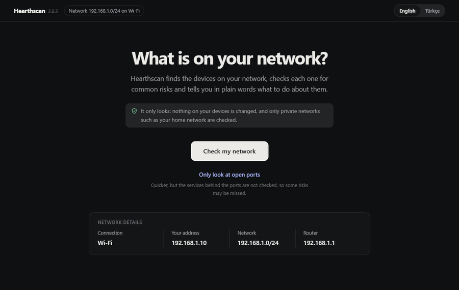
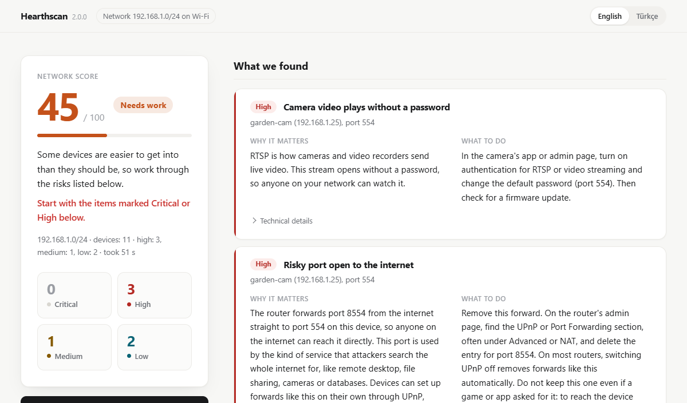
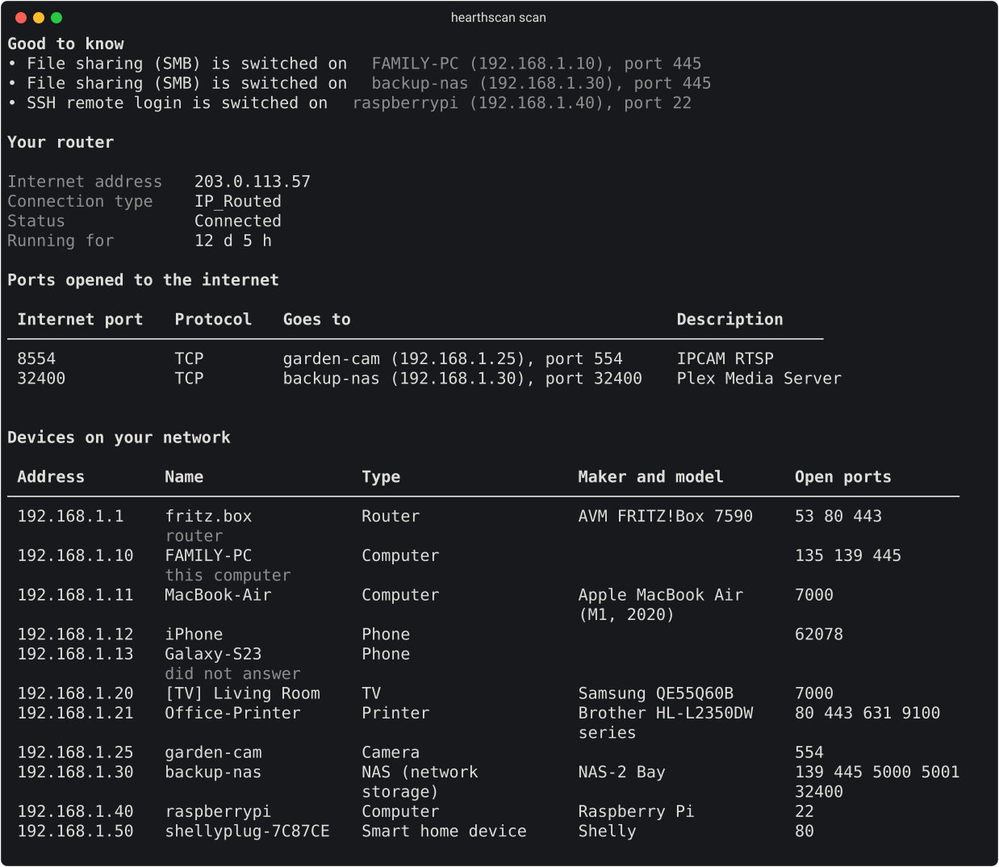

<p align="center">
  <b>English</b> | <a href="README.tr.md">Türkçe</a>
</p>

<h1 align="center">Hearthscan</h1>

<p align="center">
  
</p>

<p align="center">
  <b>Find out what is on your home network and what it exposes, in plain words.</b>
</p>

<p align="center">
  <a href="https://github.com/kalachbeg/Hearthscan/actions/workflows/ci.yml"></a>
  
  <a href="LICENSE"></a>
  
  <a href="https://github.com/kalachbeg/Hearthscan/releases/latest"></a>
  <a href="https://github.com/kalachbeg/Hearthscan/stargazers"></a>
</p>

<p align="center">
  <picture>
    <source media="(prefers-color-scheme: dark)" srcset="docs/img/window-dark.png">
    
  </picture>
</p>

<p align="center">
  
</p>

<p align="center">
  <sub>The window after a check, and the end of the same check in a terminal. The network in these pictures is made up.</sub>
</p>

<p align="center">
  <a href="#quick-start"><kbd>&nbsp;Quick start&nbsp;</kbd></a>&nbsp;
  <a href="#features"><kbd>&nbsp;Features&nbsp;</kbd></a>&nbsp;
  <a href="#what-it-checks"><kbd>&nbsp;What it checks&nbsp;</kbd></a>&nbsp;
  <a href="#usage"><kbd>&nbsp;Usage&nbsp;</kbd></a>&nbsp;
  <a href="#safety-and-privacy"><kbd>&nbsp;Safety&nbsp;</kbd></a>
</p>

<br>

Hearthscan looks at the network in your home and tells you what is on it: the router,
the computers and phones, the TV, the printer, the camera by the door and the smart plug
you forgot about. It checks each device for the risks that turn up most often in homes,
such as a camera anyone on the network can watch without a password, or a router that
lets any device open a way in from the internet. Each risk is explained in plain words,
with what to do about it.

It only looks. Nothing on your devices is changed, and nothing leaves your network. It
runs on Windows, macOS and Linux, in a terminal or in a small window of its own, in
English or Turkish, and it needs no admin rights.

---

## Quick start

Paste one line into a terminal. It downloads Hearthscan, checks the download and starts it.

<table>
<tr>
<td width="33%" valign="top">
<b>Windows 10 and 11</b><br>
Open PowerShell and paste the <a href="#windows">Windows line</a> below.
<pre>irm …/run.ps1 | iex</pre>
</td>
<td width="33%" valign="top">
<b>macOS</b><br>
Apple silicon or Intel. Open Terminal and paste the <a href="#macos-and-linux">macOS and Linux line</a> below.
<pre>curl -fsSL …/run.sh | sh</pre>
</td>
<td width="33%" valign="top">
<b>Linux</b><br>
A 64-bit PC, or ARM such as a Raspberry Pi. Open a terminal and paste the <a href="#macos-and-linux">same line</a>.
<pre>curl -fsSL …/run.sh | sh</pre>
</td>
</tr>
</table>

The full lines, ready to copy:

### Windows

Open **PowerShell** (press the Windows key, type `PowerShell`, press Enter) and paste:

```powershell
irm https://raw.githubusercontent.com/kalachbeg/Hearthscan/main/launch/run.ps1 | iex
```

### macOS and Linux

Open **Terminal** and paste:

```sh
curl -fsSL https://raw.githubusercontent.com/kalachbeg/Hearthscan/main/launch/run.sh | sh
```

Both lines fetch a small script from this repository. The script downloads the latest
release for your computer from the [Releases page](https://github.com/kalachbeg/Hearthscan/releases),
checks its SHA-256 checksum against the release's `SHA256SUMS` file, runs it from a
temporary folder and deletes that folder when Hearthscan closes. If you like to know what
you run before you run it, read [`launch/run.ps1`](launch/run.ps1) and
[`launch/run.sh`](launch/run.sh) first.

> [!NOTE]
> Nothing is installed and no admin rights are needed. The launcher will not run a
> download whose SHA-256 does not match `SHA256SUMS`, and it removes the file when you are
> done. If no release has been published yet, it says so and suggests the uv command below.

To pass a command or options, for example a scan in Turkish, put them after `sh -s --`
on macOS and Linux:

```sh
curl -fsSL https://raw.githubusercontent.com/kalachbeg/Hearthscan/main/launch/run.sh | sh -s -- scan --lang tr
```

In PowerShell, put them after the script block:

```powershell
& ([scriptblock]::Create((irm https://raw.githubusercontent.com/kalachbeg/Hearthscan/main/launch/run.ps1))) scan --lang tr
```

### Download it yourself

The same files are on the [Releases page](https://github.com/kalachbeg/Hearthscan/releases),
next to `SHA256SUMS`:

| Computer | File |
|---|---|
| Windows 10 or 11 (on ARM: Windows 11) | `hearthscan-windows-x64.exe` |
| Mac with Apple silicon (M1 and later) | `hearthscan-macos-arm64` |
| Mac with an Intel processor | `hearthscan-macos-x64` |
| Linux on a 64-bit PC | `hearthscan-linux-x64` |
| Linux on ARM, such as a Raspberry Pi 4 or 5 with a 64-bit system | `hearthscan-linux-arm64` |

On macOS and Linux, make the file executable first, then start it (with the name of the
file you downloaded):

```sh
chmod +x hearthscan-linux-x64
./hearthscan-linux-x64
```

If there is no file for your computer, uv or pipx below runs Hearthscan from source.

### With uv or pipx

If you have [uv](https://docs.astral.sh/uv/), it runs Hearthscan straight from this
repository and fetches a suitable Python by itself:

```sh
uvx --from git+https://github.com/kalachbeg/Hearthscan hearthscan
```

With the desktop window:

```sh
uvx --from "hearthscan[window] @ git+https://github.com/kalachbeg/Hearthscan" hearthscan gui
```

With [pipx](https://pipx.pypa.io/) and Python 3.10 or newer:

```sh
pipx run --spec git+https://github.com/kalachbeg/Hearthscan hearthscan
```

Hearthscan is not on PyPI yet, so these commands take it from GitHub.

### What you need

- Windows 10 or 11, macOS, or Linux.
- No admin rights.
- Python 3.10 or newer, but only to run it from source or with uv or pipx. The ready-made
  downloads bring everything they need.

> [!TIP]
> Started without a command, Hearthscan shows a small menu. The language follows your
> system; add `--lang tr` or `--lang en` to choose it yourself.

---

## Features

<table>
<tr>
<td width="33%" valign="top">
<b>Every device on the network</b><br>
Computers, phones, TVs, printers, cameras and plugs, each with a name, a maker and a guess at what it is.
</td>
<td width="33%" valign="top">
<b>Each risk in plain words</b><br>
What it is, why it matters at home, and what to click or change.
</td>
<td width="33%" valign="top">
<b>34 checks</b><br>
From Telnet and old SMB1 to a camera stream that plays without a password.
</td>
</tr>
<tr>
<td width="33%" valign="top">
<b>What your router opens</b><br>
Its internet address and every port it forwards from the internet, read over UPnP.
</td>
<td width="33%" valign="top">
<b>A score out of 100</b><br>
One number for the whole household, with the most serious risks listed first.
</td>
<td width="33%" valign="top">
<b>Watch mode</b><br>
Looks every few minutes and beeps when a device turns up that it has never seen.
</td>
</tr>
<tr>
<td width="33%" valign="top">
<b>Reports you can share</b><br>
One HTML file that opens on any phone or computer and loads nothing from the internet. <code>diff</code> shows what changed since last time.
</td>
<td width="33%" valign="top">
<b>Terminal or window</b><br>
A tidy view in the terminal, or a small window with one big start button.
</td>
<td width="33%" valign="top">
<b>English and Turkish</b><br>
Every screen and every explanation, in your system's language or the one you pick.
</td>
</tr>
</table>

---

## What it checks

Hearthscan has 34 checks, each with a severity. In the program every finding comes with a
longer explanation and the steps to fix it; here is the short version.

| Severity | Check | What it means |
|---|---|---|
| Critical | Screen sharing without a password | Anyone on your network can see and control this screen (VNC). |
| Critical | Android debugging is open to anyone | A phone, TV or TV box takes developer commands without asking (ADB). |
| Critical | Redis database without a password | Anyone on your network can read and change it, and often take over the computer. |
| Critical | Docker remote control is open to anyone | The Docker API answers without a password, which means full control of the machine. |
| High | Telnet is switched on | An old way to control a device that sends passwords as plain text. |
| High | Camera video plays without a password | Anyone on your network can watch the live stream (RTSP). |
| High | Old SMB1 file sharing is switched on | The decades-old file sharing that the WannaCry ransomware used to spread in 2017. |
| High | Smart home messages open to anyone | An MQTT broker where anyone can read sensors or switch devices on and off. |
| High | Risky port open to the internet | The router forwards remote desktop, file sharing, a camera or a database from the internet. |
| High | Video recorder service is reachable | Port 34567 or 37777 of low-cost cameras and recorders, with a long record of holes. |
| High | Elasticsearch without a password | Everything in this search database can be read, changed or deleted. |
| High | Memcached is open to the network | A cache without passwords that can also be abused to attack other sites. |
| High | Open proxy without a password | Strangers can send their traffic through your connection, and it looks like yours. |

<details>
<summary><b>Medium, low and good to know</b> (21 more checks)</summary>

<br>

| Severity | Check | What it means |
|---|---|---|
| Medium | Devices can open ports on the router | UPnP lets any device open a way in from the internet without asking you. |
| Medium | Login page without encryption | A password page without HTTPS, so the password crosses your network readable. |
| Medium | Remote Desktop is switched on | Fine with strong passwords, but a common target for password guessing. |
| Medium | Screen sharing is switched on | VNC with a password, though older logins only check its first eight characters. |
| Medium | Android debugging is switched on | ADB asks before it obeys, but one wrong tap on Allow gives full control. |
| Medium | FTP file sharing is switched on | Old file sharing that sends passwords and files as plain text. |
| Medium | Database reachable from the network | MySQL, PostgreSQL, SQL Server, MongoDB or another database takes connections from every device. |
| Medium | NFS file sharing is reachable | Folder sharing that usually trusts any device that connects. |
| Medium | rsync file sharing is reachable | Backup shares, sometimes without a password. |
| Medium | Old PPTP VPN is switched on | A VPN whose encryption was broken years ago. |
| Medium | Webmin admin panel is reachable | A web page that manages a whole server, open to every device. |
| Medium | MikroTik Winbox management is reachable | The router's management tool, which had serious holes in old versions. |
| Low | Outdated encryption | TLS 1.0 or 1.1, retired in 2021. |
| Low | Printer accepts jobs from any device | Normal for home printers, listed so you know. |
| Low | Port open to the internet | A forward to something less risky, such as a game console or a media server. |
| Low | Provider remote management is reachable | The modem's TR-069 service also answers inside your home. |
| Info | File sharing (SMB) is switched on | Shows which devices share files. |
| Info | SSH remote login is switched on | Fine with strong passwords or keys. |
| Info | Device we could not identify | Worth checking against the router's list of devices. |
| Info | Router behind another router | Double NAT: port forwards and some games may not work. |
| Info | Internet address shared with other customers | CGNAT: nothing on the internet can reach you directly. |

</details>

---

## Usage

### The menu

Run `hearthscan` without a command and choose by number:

```text
╭───────────────────────────────────╮
│  Hearthscan 2.0.0                 │
│  Network 192.168.1.0/24 on Wi-Fi  │
╰───────────────────────────────────╯
  1  Check my network
  2  Open the window
  3  Watch my network
  4  List the devices
  5  Check my router
  6  Show network details
  q  Quit
Choose [1/2/3/4/5/6/q] (1):
```

### Commands

| Command | What it does |
|---|---|
| `hearthscan scan` | The full check: devices, open ports, services, the router, the risks and a score. |
| `hearthscan gui` | Opens the window. Also number 2 in the menu. |
| `hearthscan devices` | Lists the devices, without looking at their ports. |
| `hearthscan router` | Asks the router for its internet address and the ports it forwards. Changes nothing. |
| `hearthscan net` | Shows your connection, your address, the network and the router. |
| `hearthscan watch` | Looks every few minutes and tells you when a device turns up, comes back or leaves. |
| `hearthscan known` | Lists the devices watch mode remembers. Mark the ones you know as trusted. |
| `hearthscan report RESULT.json` | Turns a saved result into an HTML report. |
| `hearthscan diff OLD.json NEW.json` | Shows what changed between two saved results. |
| `hearthscan ports TARGETS` | Checks TCP ports on addresses you choose, inside your own network only. |

Every command takes `--lang en` or `--lang tr`, and `hearthscan COMMAND --help` lists the
rest.

The examples below use the `hearthscan` command. If you start Hearthscan with a launcher
line, add the command and its options at the end, as shown in [Quick start](#quick-start).
To keep the command at hand, install it with uv or pipx:

```sh
uv tool install git+https://github.com/kalachbeg/Hearthscan
pipx install git+https://github.com/kalachbeg/Hearthscan
```

### Examples

```sh
# Check the network and save a report you can open in any browser
hearthscan scan -o report.html

# Save today's result, then compare it with a later one
hearthscan scan -o monday.json
hearthscan diff monday.json friday.json

# Keep an eye on the network every ten minutes, with the full check each time
hearthscan watch --every 10 --full

# Tell watch mode that the printer is yours
hearthscan known --trust 192.168.1.21

# Look at chosen ports on one device
hearthscan ports 192.168.1.20 -p 22,80,443,8000-8100

# In a script: exit with status 3 when anything high or critical turns up
hearthscan scan --fail-on high -o result.json
```

<details>
<summary><b>All options</b></summary>

<br>

| Command | Option | What it does |
|---|---|---|
| any | `--lang en`, `--lang tr` | The language of the output. Default: your system's language. |
| `hearthscan` | `--version` | Prints the version. |
| `scan` | `-p`, `--ports LIST` | Ports to check instead of the usual 56 home ports, for example `22,80,8000-8100`. |
| `scan` | `-t`, `--timeout SECONDS` | How long to wait for each port, up to 60. Default 1. |
| `scan` | `--no-probe` | Only list open ports. Skips the password checks, so some risks are missed. |
| `scan` | `--json` | Prints the result as JSON. |
| `scan` | `-o`, `--output FILE` | Also saves the result: an HTML report when FILE ends in `.html`, JSON otherwise. |
| `scan` | `--fail-on SEVERITY` | Exits with status 3 when anything this serious or worse turns up (`critical`, `high`, `medium`, `low`, `info`). |
| `devices`, `net`, `router`, `diff` | `--json` | Prints it as JSON. |
| `report` | `-o`, `--output FILE` | Where to write the report. Default: next to the result, ending in `.html`. |
| `watch` | `--every MINUTES` | Minutes between checks, at least 0.5. Default 5. |
| `watch` | `--full` | Runs the full check each time and reports new risks too. Slower. |
| `known` | `--trust DEVICE`, `--untrust DEVICE` | Marks a device as trusted, or takes the mark away. DEVICE is a MAC or an address. |
| `known` | `--forget DEVICE`, `--clear` | Forgets one device, or all of them. |
| `known` | `--json` | Prints the list as JSON. |
| `ports` | `-p`, `--ports LIST`, `-t`, `--timeout SECONDS` | As for `scan`. TARGETS is an address, a range or a network such as `192.168.1.0/24`. |
| `gui` | `--browser` | Opens it in your web browser instead of a window. |

| Exit status | Meaning |
|---|---|
| 0 | Done. |
| 1 | No local network found. |
| 2 | Bad arguments, or a file could not be read or saved. |
| 3 | `--fail-on` found something that serious. |
| 130 | Stopped with Ctrl+C. |

| Environment variable | What it does |
|---|---|
| `HEARTHSCAN_LANG` | The language, `en` or `tr`. |
| `HEARTHSCAN_STATE_DIR` | Where watch mode keeps the devices it has seen. Default: `%LOCALAPPDATA%\Hearthscan` on Windows, `~/Library/Application Support/Hearthscan` on macOS, `~/.local/state/hearthscan` on Linux. |
| `HEARTHSCAN_VERSION` | Makes the launchers run that release, such as `2.0.0`, instead of the latest one. |

</details>

### The window

`hearthscan gui`, or 2 in the menu, shows the same check in a window: a big start button,
live progress, the results as cards, the router and a device list you can search. It only
listens on your own computer: the page is served on 127.0.0.1 behind a random token and
loads nothing from the internet. Where no window can open, it opens in your web browser
instead, and `--browser` asks for the browser on purpose.

---

## How it works

<table>
<tr>
<td width="33%" valign="top">
<b>1. Find the devices</b><br>
A NetBIOS query to every address makes your computer list each device in its neighbor table, which Hearthscan reads without admin rights. mDNS, SSDP and the router add the names.
</td>
<td width="33%" valign="top">
<b>2. Tell them apart</b><br>
The maker comes from the MAC address. Clues such as services, open ports and names decide whether it is a phone, a printer or a camera.
</td>
<td width="33%" valign="top">
<b>3. Check the ports</b><br>
A TCP connect scan of 56 ports that are common at home. Ports that stay silent get a second try, since Wi-Fi loses packets now and then.
</td>
</tr>
<tr>
<td width="33%" valign="top">
<b>4. Look closer, read only</b><br>
Light probes name each service and see whether it asks for a password. They never log in or change anything, and printers get no bytes at all.
</td>
<td width="33%" valign="top">
<b>5. Ask the router</b><br>
Over UPnP, four questions that only read: the internet address, the connection status and type, and the list of port forwards.
</td>
<td width="33%" valign="top">
<b>6. Score it</b><br>
Critical costs 30 points, high 15, medium 6 and low 2, and repeats count half. 90 and above is Good, below 40 is At risk.
</td>
</tr>
</table>

<details>
<summary><b>The longer version</b></summary>

<br>

1. **Finding devices, without admin rights.** Hearthscan sends a NetBIOS name query to
   every address in your network. Windows PCs and NAS boxes answer with their names, and
   every query also makes your computer learn the device's hardware (MAC) address, so
   afterwards the system's neighbor table (the ARP table) lists everything that is
   switched on, firewall or not. Hearthscan reads that table instead of sending raw
   packets. At the same time it listens for mDNS (Bonjour) and SSDP (UPnP) announcements
   and asks the router for the names it handed out.
2. **Telling devices apart.** The maker comes from the first part of each MAC address,
   looked up in the IEEE registry that ships with Hearthscan. Every clue adds weight to one
   kind of device: a service only printers offer, a UPnP device type, the maker, the open
   ports, a name like `DESKTOP-...` or `iPhone`. The kind with the most weight wins.
3. **Checking ports.** A TCP connect scan of 56 ports that are common at home: remote
   access, file sharing, printers, cameras, router management, media boxes and the odd
   forgotten database. Ports that look filtered get a second try, since a lost packet is
   common on Wi-Fi.
4. **Looking closer, read only.** For each open port, a light probe speaks just enough of
   the protocol to name the service and see whether it asks for a password: an SSH
   greeting, a web page title and login form, an RTSP request without a password, an SMB
   handshake that offers only SMB1. No probe logs in, sends a password or changes
   anything, and printers get no bytes at all, because whatever reaches a print port comes
   out on paper.
5. **Asking the router.** If the router speaks UPnP, Hearthscan asks it four questions
   that only read: its internet address, its connection status, its connection type and
   its list of port forwards.
6. **Scoring.** Every finding takes points off 100: critical 30, high 15, medium 6, low 2,
   good to know nothing. The same problem on several devices counts half for each repeat,
   up to three times its weight, so five cameras with the same hole do not sink the score
   on their own. 90 and above is Good, 70 to 89 Fair, 40 to 69 Needs work, and below 40
   At risk.

</details>

---

## Safety and privacy

> [!IMPORTANT]
> Only scan networks that are yours, or that you have permission to check.

- **Private networks only.** Hearthscan works on home and other private networks
  (192.168.x.x, 10.x.x.x, 172.16.x.x to 172.31.x.x and link-local addresses) and refuses
  public addresses, in every command.
- **It only looks.** Probes read what a service offers on its own and do the handshake
  needed to see whether it wants a password. They never log in, never write or change
  anything, and leave printers alone. The router is only asked questions.
- **Nothing leaves your network.** Hearthscan sends nothing to the internet: no
  telemetry, no accounts, no update checks. The window's page is served on 127.0.0.1 and
  loads nothing from outside. Only the one-line launchers go online, to download Hearthscan
  from GitHub.
- **Reports are personal.** Saved reports and JSON results contain your device names and
  addresses. Share them only with people you trust, and look through one before you attach
  it to an issue.
- **What it remembers.** Watch mode keeps the devices it has seen in a small file in your
  user folder. `hearthscan known --clear` empties it.

If you find a security problem in Hearthscan itself, please report it privately, as
described under [Security](#security).

---

## From NetShark to Hearthscan

Hearthscan began as NetShark, a general purpose scanner I wrote for ports, subdomains and
web servers. It did its job, but tools like nmap have done that job well for a long time,
and one more scanner of the same kind did not help anyone much.

So I asked myself what would be more useful, and the answer was smaller and closer to
home: a tool for anyone who wants to understand their own home network. It should find
the devices, check them for the problems that really turn up in homes, and explain each
one without assuming you know what a port is.

Version 2.0 is that rewrite, under a new name. The 1.x releases were NetShark. That code
is no longer maintained, and links to the old repository redirect here. The subdomain and
web checks from NetShark are gone on purpose: other tools cover them better.
[CHANGELOG.md](CHANGELOG.md) lists what changed.

---

## Known limitations

- **Devices are found over IPv4 only.** A device that only speaks IPv6 is not listed. The
  `ports` command does accept IPv6 addresses.
- **Quiet devices can hide.** A device whose firewall drops everything may be missed, or
  listed as "did not answer" when only the neighbor table knows about it.
- **mDNS hears less on Windows.** Listening on the shared mDNS port would make Windows
  Firewall block Hearthscan or ask you about it, so it skips that, and some devices may
  show without a name or model.
- **No raw ARP.** Sending raw ARP packets needs admin rights, so Hearthscan reads the
  system's neighbor table instead. That table can remember a device for a while after it
  has left.
- **The window on Linux** needs GTK or Qt for pywebview. Without them, and in the
  ready-made Linux downloads, Hearthscan opens in your web browser instead.

> [!WARNING]
> Antivirus programs sometimes flag one-file Python programs like the Hearthscan
> downloads, because of the way they unpack themselves. If yours does, compare the file
> with `SHA256SUMS` on the Releases page, or run Hearthscan with uv or pipx instead.
> The macOS download is not notarized by Apple. Started by the launcher it runs, but a
> copy downloaded in a browser is blocked the first time: allow it under System Settings,
> Privacy & Security.

---

## Development

You need [uv](https://docs.astral.sh/uv/). It installs the right Python by itself.

```sh
git clone https://github.com/kalachbeg/Hearthscan.git
cd Hearthscan
uv sync
uv run pytest
uv run hearthscan
uv run --extra window hearthscan gui
```

Before you open a pull request:

```sh
uv run ruff check
uv run ruff format
uv run pytest
```

CI runs the same on Windows, macOS and Linux with the oldest and newest supported Python.
The pictures in this README come from a made-up network: `uv run python scripts/screenshots.py`
draws them again. The window pictures need Edge, Chrome or Chromium.

## Contributing

Bug reports, device detection fixes, new checks, better Turkish and documentation are all
welcome. Please start with [CONTRIBUTING.md](CONTRIBUTING.md), and for anything bigger
than a small fix, open an issue first so we can agree on the approach. Questions are
welcome in [Discussions](https://github.com/kalachbeg/Hearthscan/discussions). Be kind:
[CODE_OF_CONDUCT.md](CODE_OF_CONDUCT.md).

## Security

Please do not report security problems in public issues. Use GitHub's
[private vulnerability reporting](https://github.com/kalachbeg/Hearthscan/security/advisories/new)
instead. [SECURITY.md](SECURITY.md) explains what counts and what happens next.

## License

Hearthscan is released under the [MIT License](LICENSE).

## Star history

<a href="https://star-history.com/#kalachbeg/hearthscan&Date">
  <picture>
    <source media="(prefers-color-scheme: dark)" srcset="https://api.star-history.com/svg?repos=kalachbeg/hearthscan&type=Date&theme=dark" />
    <source media="(prefers-color-scheme: light)" srcset="https://api.star-history.com/svg?repos=kalachbeg/hearthscan&type=Date" />
    
  </picture>
</a>
