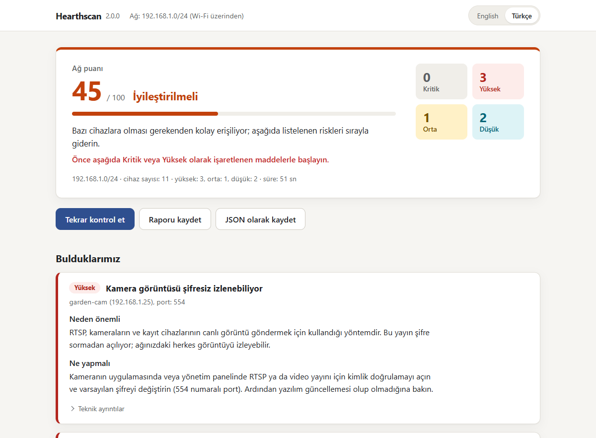
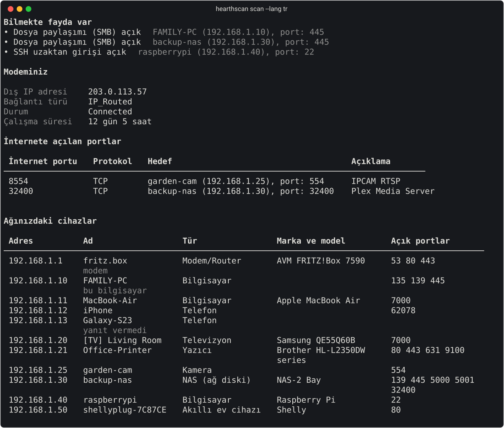

<p align="center">
  <a href="README.md">English</a> | <b>Türkçe</b>
</p>

<h1 align="center">Hearthscan</h1>

<p align="center">
  <b>Ev ağınızda neler olduğunu ve nelerin açıkta kaldığını sade bir dille anlatır.</b>
</p>

<p align="center">
  <a href="https://github.com/kalachbeg/Hearthscan/actions/workflows/ci.yml"></a>
  
  <a href="LICENSE"></a>
  
  <a href="https://github.com/kalachbeg/Hearthscan/releases/latest"></a>
  <a href="https://github.com/kalachbeg/Hearthscan/stargazers"></a>
</p>

<p align="center">
  <a href="#hızlı-başlangıç"><kbd>&nbsp;Hızlı başlangıç&nbsp;</kbd></a>&nbsp;
  <a href="#özellikler"><kbd>&nbsp;Özellikler&nbsp;</kbd></a>&nbsp;
  <a href="#neleri-kontrol-eder"><kbd>&nbsp;Neleri kontrol eder&nbsp;</kbd></a>&nbsp;
  <a href="#kullanım"><kbd>&nbsp;Kullanım&nbsp;</kbd></a>&nbsp;
  <a href="#güvenlik-ve-gizlilik"><kbd>&nbsp;Güvenlik&nbsp;</kbd></a>
</p>

<br>

Hearthscan evinizdeki ağa bakar ve üzerinde neler olduğunu söyler: modem, bilgisayarlar,
telefonlar, televizyon, yazıcı, kapıdaki kamera, bir de çoktan unuttuğunuz akıllı priz.
Her cihazı evlerde en sık karşılaşılan risklere karşı kontrol eder. Ağdaki herkesin şifre
girmeden izleyebildiği bir kamera ya da her cihazın internetten içeri yol açmasına izin
veren bir modem bunlara örnektir. Bulduğu her riski sade bir dille, ne yapmanız
gerektiğiyle birlikte anlatır.

Yalnızca bakar: cihazlarınızda hiçbir şeyi değiştirmez ve hiçbir bilgi ağınızın dışına
çıkmaz. Windows, macOS ve Linux'ta, ister terminalde ister kendi küçük penceresinde,
Türkçe ya da İngilizce çalışır. Yönetici izni de istemez.

<p align="center">
  <picture>
    <source media="(prefers-color-scheme: dark)" srcset="docs/img/window-dark-tr.png">
    
  </picture>
</p>

<p align="center">
  
</p>

<p align="center">
  <sub>Bir kontrolün ardından pencere ve aynı kontrolün terminaldeki sonu. Resimlerdeki ağ gerçek değildir, örnek olarak hazırlanmıştır.</sub>
</p>

---

## Hızlı başlangıç

Bir terminale tek satır yapıştırmanız yeterli. Bu satır Hearthscan'i indirir, indirileni
doğrular ve çalıştırır.

<table>
<tr>
<td width="33%" valign="top">
<b>Windows 10 ve 11</b><br>
PowerShell'i açın ve aşağıdaki <a href="#windows">Windows satırını</a> yapıştırın.
<pre>irm …/run.ps1 | iex</pre>
</td>
<td width="33%" valign="top">
<b>macOS</b><br>
Apple çipli ya da Intel. Terminal'i açın ve aşağıdaki <a href="#macos-ve-linux">macOS ve Linux satırını</a> yapıştırın.
<pre>curl -fsSL …/run.sh | sh</pre>
</td>
<td width="33%" valign="top">
<b>Linux</b><br>
64 bit bir PC ya da Raspberry Pi gibi bir ARM cihaz. Bir terminal açın ve <a href="#macos-ve-linux">aynı satırı</a> yapıştırın.
<pre>curl -fsSL …/run.sh | sh</pre>
</td>
</tr>
</table>

Kopyalamaya hazır tam satırlar:

### Windows

**PowerShell**'i açın (Windows tuşuna basın, `PowerShell` yazın, Enter'a basın) ve şunu
yapıştırın:

```powershell
irm https://raw.githubusercontent.com/kalachbeg/Hearthscan/main/launch/run.ps1 | iex
```

### macOS ve Linux

**Terminal**'i açın ve şunu yapıştırın:

```sh
curl -fsSL https://raw.githubusercontent.com/kalachbeg/Hearthscan/main/launch/run.sh | sh
```

İki satır da bu depodan küçük bir betik getirir. Betik, bilgisayarınıza uygun son sürümü
[Releases sayfasından](https://github.com/kalachbeg/Hearthscan/releases) indirir, SHA-256
özetini sürümdeki `SHA256SUMS` dosyasıyla karşılaştırır, programı geçici bir klasörden
çalıştırır ve Hearthscan kapanınca o klasörü siler. Çalıştırmadan önce ne yaptığını görmek
isterseniz [`launch/run.ps1`](launch/run.ps1) ve [`launch/run.sh`](launch/run.sh)
dosyalarına göz atabilirsiniz.

> [!NOTE]
> Hiçbir şey kurulmaz, yönetici izni de gerekmez. İndirilen dosyanın SHA-256 özeti
> `SHA256SUMS` ile uyuşmazsa başlatıcı onu çalıştırmaz; işiniz bitince de dosyayı siler.
> Henüz yayımlanmış bir sürüm yoksa bunu söyler ve aşağıdaki uv komutunu önerir.

Komut ya da seçenek eklemek isterseniz, örneğin Türkçe bir tarama için, macOS ve Linux'ta
bunları `sh -s --` kısmından sonra yazın:

```sh
curl -fsSL https://raw.githubusercontent.com/kalachbeg/Hearthscan/main/launch/run.sh | sh -s -- scan --lang tr
```

PowerShell'de ise betik bloğundan sonra:

```powershell
& ([scriptblock]::Create((irm https://raw.githubusercontent.com/kalachbeg/Hearthscan/main/launch/run.ps1))) scan --lang tr
```

### Kendiniz indirin

Aynı dosyalar `SHA256SUMS` ile birlikte
[Releases sayfasında](https://github.com/kalachbeg/Hearthscan/releases) duruyor:

| Bilgisayar | Dosya |
|---|---|
| Windows 10 veya 11 (ARM'de Windows 11) | `hearthscan-windows-x64.exe` |
| Apple çipli Mac (M1 ve sonrası) | `hearthscan-macos-arm64` |
| Intel işlemcili Mac | `hearthscan-macos-x64` |
| 64 bit bir PC'de Linux | `hearthscan-linux-x64` |
| ARM'de Linux, örneğin 64 bit sistemli Raspberry Pi 4 veya 5 | `hearthscan-linux-arm64` |

macOS ve Linux'ta önce dosyayı çalıştırılabilir yapın, sonra başlatın (indirdiğiniz
dosyanın adıyla):

```sh
chmod +x hearthscan-linux-x64
./hearthscan-linux-x64
```

Bilgisayarınıza uygun bir dosya yoksa aşağıdaki uv veya pipx yolu Hearthscan'i kaynak
koddan çalıştırır.

### uv veya pipx ile

[uv](https://docs.astral.sh/uv/) yüklüyse Hearthscan'i doğrudan bu depodan çalıştırır,
uygun Python sürümünü de kendisi getirir:

```sh
uvx --from git+https://github.com/kalachbeg/Hearthscan hearthscan
```

Masaüstü penceresiyle birlikte:

```sh
uvx --from "hearthscan[window] @ git+https://github.com/kalachbeg/Hearthscan" hearthscan gui
```

[pipx](https://pipx.pypa.io/) ve Python 3.10 veya üstüyle:

```sh
pipx run --spec git+https://github.com/kalachbeg/Hearthscan hearthscan
```

Hearthscan henüz PyPI'da yok; bu komutlar onu GitHub'dan alır.

### Gerekenler

- Windows 10 veya 11, macOS ya da Linux.
- Yönetici izni gerekmez.
- Python 3.10 veya üstü, ama yalnızca kaynak koddan ya da uv veya pipx ile çalıştırırken.
  Hazır indirmeler ihtiyaç duydukları her şeyi yanlarında getirir.

> [!TIP]
> Komut vermeden başlatırsanız Hearthscan küçük bir menü açar. Dil sisteminize göre
> seçilir; Windows'un görüntüleme dili Türkçeyse kendiliğinden Türkçe açılır. İsterseniz
> `--lang tr` veya `--lang en` ile kendiniz seçebilirsiniz.

---

## Özellikler

<table>
<tr>
<td width="33%" valign="top">
<b>Ağdaki her cihaz</b><br>
Bilgisayarlar, telefonlar, televizyonlar, yazıcılar, kameralar ve prizler; her biri adı, markası ve ne olduğuna dair bir tahminle.
</td>
<td width="33%" valign="top">
<b>Her risk sade bir dille</b><br>
Ne olduğu, evde neden önemli olduğu ve neyi değiştirmeniz gerektiği.
</td>
<td width="33%" valign="top">
<b>34 kontrol</b><br>
Telnet'ten eski SMB1'e, şifresiz izlenebilen kamera yayınına kadar.
</td>
</tr>
<tr>
<td width="33%" valign="top">
<b>Modeminizin açtıkları</b><br>
Dış IP adresi ve internetten içeri yönlendirdiği her port, UPnP üzerinden okunur.
</td>
<td width="33%" valign="top">
<b>100 üzerinden bir puan</b><br>
Bütün ev için tek bir sayı; en ciddi riskler en üstte.
</td>
<td width="33%" valign="top">
<b>İzleme modu</b><br>
Birkaç dakikada bir bakar, daha önce hiç görmediği bir cihaz gelince bip sesiyle haber verir.
</td>
</tr>
<tr>
<td width="33%" valign="top">
<b>Paylaşabileceğiniz raporlar</b><br>
Her telefonda ve bilgisayarda açılan, internetten hiçbir şey yüklemeyen tek bir HTML dosyası. <code>diff</code> son kontrolden beri nelerin değiştiğini gösterir.
</td>
<td width="33%" valign="top">
<b>Terminalde ya da pencerede</b><br>
Terminalde derli toplu bir görünüm ya da tek büyük düğmeli küçük bir pencere.
</td>
<td width="33%" valign="top">
<b>Türkçe ve İngilizce</b><br>
Her ekran ve her açıklama, sisteminizin dilinde ya da sizin seçtiğiniz dilde.
</td>
</tr>
</table>

---

## Neleri kontrol eder

Hearthscan'de her biri bir önem derecesine sahip 34 kontrol var. Program her bulguyu daha
uzun bir açıklama ve adım adım çözümle birlikte gösterir; burada kısa hâlleri yer alıyor.

| Önem | Kontrol | Ne anlama gelir |
|---|---|---|
| Kritik | Ekran paylaşımı şifresiz açık | Ağınızdaki herkes bu ekranı görüp yönetebilir (VNC). |
| Kritik | Android hata ayıklama herkese açık | Telefon, televizyon veya TV kutusu, onay istemeden geliştirici komutlarını kabul ediyor (ADB). |
| Kritik | Redis veritabanı şifresiz | Ağdaki herkes içeriğini okuyup değiştirebilir, çoğu zaman bilgisayarı da ele geçirebilir. |
| Kritik | Docker uzaktan yönetimi herkese açık | Docker API şifre sormadan yanıt veriyor; bu, bilgisayarın tam kontrolü demek. |
| Yüksek | Telnet açık | Şifreleri açık metin olarak gönderen eski bir uzaktan yönetim yolu. |
| Yüksek | Kamera görüntüsü şifresiz izlenebiliyor | Ağınızdaki herkes canlı yayını izleyebilir (RTSP). |
| Yüksek | Eski SMB1 dosya paylaşımı açık | WannaCry fidye yazılımının 2017'de yayılırken kullandığı, onlarca yıllık dosya paylaşımı. |
| Yüksek | Akıllı ev mesajları herkese açık | Herkesin sensörleri okuyup cihazları açıp kapatabildiği bir MQTT sunucusu. |
| Yüksek | Riskli bir port internete açık | Modem, internetten gelen bağlantıları uzak masaüstü, dosya paylaşımı, kamera veya veritabanı gibi bir servise yönlendiriyor. |
| Yüksek | Kayıt cihazı servisi açık | Ucuz kamera ve kayıt cihazlarının 34567 veya 37777 numaralı portu; açıklarla dolu bir geçmişi var. |
| Yüksek | Elasticsearch şifresiz | Bu arama veritabanındaki her şey okunabilir, değiştirilebilir veya silinebilir. |
| Yüksek | Memcached ağa açık | Şifresiz bir önbellek; başka sitelere saldırmak için de kötüye kullanılabilir. |
| Yüksek | Şifresiz açık proxy | Yabancılar trafiklerini sizin bağlantınızdan geçirebilir ve her şey sizden geliyormuş gibi görünür. |

<details>
<summary><b>Orta, düşük ve bilgi amaçlı</b> (21 kontrol daha)</summary>

<br>

| Önem | Kontrol | Ne anlama gelir |
|---|---|---|
| Orta | Cihazlar modemde kendi kendine port açabiliyor | UPnP, herhangi bir cihazın size sormadan internetten içeri bir yol açmasına izin verir. |
| Orta | Giriş sayfası şifrelemesiz | HTTPS kullanmayan bir sayfada şifre isteniyor; şifre ağda okunabilir hâlde gider. |
| Orta | Uzak Masaüstü açık | Güçlü şifrelerle sorun çıkarmaz, ama şifre deneme saldırılarının sık hedefidir. |
| Orta | Ekran paylaşımı açık | Şifreli VNC, ama eski girişler şifrenin yalnızca ilk sekiz karakterine bakar. |
| Orta | Android hata ayıklama açık | ADB komutlardan önce onay ister, ama yanlışlıkla verilen tek bir izin tam kontrol demektir. |
| Orta | FTP dosya paylaşımı açık | Şifreleri ve dosyaları açık metin olarak gönderen eski bir paylaşım yolu. |
| Orta | Veritabanı ağa açık | MySQL, PostgreSQL, SQL Server, MongoDB ya da başka bir veritabanı her cihazdan bağlantı kabul ediyor. |
| Orta | NFS dosya paylaşımı açık | Genellikle bağlanan her cihaza güvenen bir klasör paylaşımı. |
| Orta | rsync dosya paylaşımı açık | Yedekleme paylaşımları; bazen şifre bile sormaz. |
| Orta | Eski PPTP VPN açık | Şifrelemesi yıllar önce kırılmış bir VPN. |
| Orta | Webmin yönetim paneli açık | Bütün bir sunucuyu yöneten bir web sayfası, her cihaza açık. |
| Orta | MikroTik Winbox yönetimi açık | MikroTik cihazlarının yönetim aracı; eski sürümlerinde ciddi açıklar vardı. |
| Düşük | Eski şifreleme sürümü | 2021'de kullanımdan kaldırılan TLS 1.0 veya 1.1. |
| Düşük | Yazıcı her cihazdan baskı kabul ediyor | Ev yazıcılarında normaldir; bilmeniz için listelenir. |
| Düşük | Bir port internete açık | Oyun konsolu veya medya sunucusu gibi daha az riskli bir şeye yönlendirme. |
| Düşük | Sağlayıcının uzaktan yönetim servisi açık | Modemin TR-069 servisi ev ağınızın içinden de yanıt veriyor. |
| Bilgi | Dosya paylaşımı (SMB) açık | Hangi cihazların dosya paylaştığını gösterir. |
| Bilgi | SSH uzaktan girişi açık | Güçlü şifre ya da anahtarla sorun değildir. |
| Bilgi | Tanımlanamayan cihaz | Modemin cihaz listesiyle karşılaştırmakta fayda var. |
| Bilgi | Modeminiz başka bir modemin arkasında | Çift NAT: port yönlendirme ve bazı oyunlar çalışmayabilir. |
| Bilgi | İnternet adresiniz başka abonelerle ortak | CGNAT: internetten kimse size doğrudan ulaşamaz. |

</details>

---

## Kullanım

### Menü

`hearthscan` komutunu tek başına çalıştırın ve numarayla seçin:

```text
╭────────────────────────────────────────╮
│  Hearthscan 2.0.0                      │
│  Ağ: 192.168.1.0/24 (Wi-Fi üzerinden)  │
╰────────────────────────────────────────╯
  1  Ağımı kontrol et
  2  Pencereyi aç
  3  Ağımı izle
  4  Cihazları listele
  5  Modemimi kontrol et
  6  Ağ bilgilerini göster
  q  Çıkış
Seçiminiz [1/2/3/4/5/6/q] (1):
```

### Komutlar

| Komut | Ne yapar |
|---|---|
| `hearthscan scan` | Tam kontrol: cihazlar, açık portlar, servisler, modem, riskler ve puan. |
| `hearthscan gui` | Pencereyi açar. Menüde 2 numara. |
| `hearthscan devices` | Portlarına bakmadan cihazları listeler. |
| `hearthscan router` | Modeme dış IP adresini ve yönlendirdiği portları sorar. Hiçbir şeyi değiştirmez. |
| `hearthscan net` | Bağlantınızı, adresinizi, ağınızı ve modeminizi gösterir. |
| `hearthscan watch` | Birkaç dakikada bir bakar; yeni gelen, geri dönen veya ayrılan cihazları haber verir. |
| `hearthscan known` | İzleme modunun hatırladığı cihazları listeler. Tanıdıklarınızı güvenilir olarak işaretleyebilirsiniz. |
| `hearthscan report SONUÇ.json` | Kaydedilmiş bir sonucu HTML rapora çevirir. |
| `hearthscan diff ESKİ.json YENİ.json` | Kaydedilmiş iki sonuç arasında nelerin değiştiğini gösterir. |
| `hearthscan ports HEDEFLER` | Seçtiğiniz adreslerde TCP portlarını kontrol eder; yalnızca kendi ağınızda. |

Her komut `--lang tr` veya `--lang en` alır; geri kalan seçenekleri
`hearthscan KOMUT --help` listeler.

Aşağıdaki örneklerde `hearthscan` komutu kullanılıyor. Hearthscan'i başlatıcı satırıyla
çalıştırıyorsanız komutu ve seçenekleri, [Hızlı başlangıç](#hızlı-başlangıç) bölümündeki
gibi satırın sonuna ekleyin. Komutu hep elinizin altında tutmak isterseniz uv veya pipx ile
kurabilirsiniz:

```sh
uv tool install git+https://github.com/kalachbeg/Hearthscan
pipx install git+https://github.com/kalachbeg/Hearthscan
```

### Örnekler

```sh
# Ağı kontrol edin ve her tarayıcıda açılan bir rapor kaydedin
hearthscan scan -o rapor.html

# Bugünkü sonucu kaydedin, sonra daha yeni bir sonuçla karşılaştırın
hearthscan scan -o pazartesi.json
hearthscan diff pazartesi.json cuma.json

# Ağı on dakikada bir izleyin, her seferinde tam kontrolle
hearthscan watch --every 10 --full

# Yazıcının sizin olduğunu izleme moduna bildirin
hearthscan known --trust 192.168.1.21

# Tek bir cihazda seçtiğiniz portlara bakın
hearthscan ports 192.168.1.20 -p 22,80,443,8000-8100

# Betiklerde: yüksek ya da kritik bir şey çıkarsa 3 çıkış koduyla bitirin
hearthscan scan --fail-on high -o sonuc.json
```

<details>
<summary><b>Bütün seçenekler</b></summary>

<br>

| Komut | Seçenek | Ne yapar |
|---|---|---|
| hepsi | `--lang tr`, `--lang en` | Çıktının dili. Varsayılan: sisteminizin dili. |
| `hearthscan` | `--version` | Sürümü yazar. |
| `scan` | `-p`, `--ports LİSTE` | Her zamanki 56 ev portu yerine bakılacak portlar, örneğin `22,80,8000-8100`. |
| `scan` | `-t`, `--timeout SANİYE` | Her port için ne kadar bekleneceği, en fazla 60. Varsayılan 1. |
| `scan` | `--no-probe` | Yalnızca açık portları listeler. Şifre kontrollerini atladığı için bazı riskler gözden kaçar. |
| `scan` | `--json` | Sonucu JSON olarak yazar. |
| `scan` | `-o`, `--output DOSYA` | Sonucu ayrıca kaydeder: DOSYA `.html` ile bitiyorsa HTML rapor, değilse JSON. |
| `scan` | `--fail-on ÖNEM` | Bu derecede ya da daha ciddi bir şey çıkarsa 3 çıkış koduyla biter (`critical`, `high`, `medium`, `low`, `info`). |
| `devices`, `net`, `router`, `diff` | `--json` | Çıktıyı JSON olarak yazar. |
| `report` | `-o`, `--output DOSYA` | Raporun yazılacağı yer. Varsayılan: sonucun yanında, `.html` uzantısıyla. |
| `watch` | `--every DAKİKA` | Kontroller arasındaki dakika, en az 0.5. Varsayılan 5. |
| `watch` | `--full` | Her seferinde tam kontrol yapar ve yeni riskleri de bildirir. Daha yavaştır. |
| `known` | `--trust CİHAZ`, `--untrust CİHAZ` | Cihazı güvenilir olarak işaretler ya da işareti kaldırır. CİHAZ bir MAC ya da IP adresidir. |
| `known` | `--forget CİHAZ`, `--clear` | Bir cihazı ya da hepsini unutur. |
| `known` | `--json` | Listeyi JSON olarak yazar. |
| `ports` | `-p`, `--ports LİSTE`, `-t`, `--timeout SANİYE` | `scan` ile aynı. HEDEFLER bir adres, bir aralık ya da `192.168.1.0/24` gibi bir ağdır. |
| `gui` | `--browser` | Pencere yerine web tarayıcınızda açar. |

| Çıkış kodu | Anlamı |
|---|---|
| 0 | Tamamlandı. |
| 1 | Yerel ağ bulunamadı. |
| 2 | Hatalı seçenek ya da okunamayan veya kaydedilemeyen bir dosya. |
| 3 | `--fail-on` o derecede bir şey buldu. |
| 130 | Ctrl+C ile durduruldu. |

| Ortam değişkeni | Ne yapar |
|---|---|
| `HEARTHSCAN_LANG` | Dil: `tr` veya `en`. |
| `HEARTHSCAN_STATE_DIR` | İzleme modunun gördüğü cihazları sakladığı klasör. Varsayılan: Windows'ta `%LOCALAPPDATA%\Hearthscan`, macOS'ta `~/Library/Application Support/Hearthscan`, Linux'ta `~/.local/state/hearthscan`. |
| `HEARTHSCAN_VERSION` | Başlatıcıların son sürüm yerine belirli bir sürümü, örneğin `2.0.0`, çalıştırmasını sağlar. |

</details>

### Pencere

`hearthscan gui` ya da menüdeki 2 numara, aynı kontrolü bir pencerede gösterir: büyük bir
başlat düğmesi, canlı ilerleme, kartlar hâlinde sonuçlar, modem bilgileri ve içinde arama
yapabileceğiniz bir cihaz listesi. Yalnızca kendi bilgisayarınızda çalışır: sayfa
127.0.0.1 üzerinde, rastgele bir anahtarın arkasında sunulur ve internetten hiçbir şey
yüklemez. Pencere açılamayan yerlerde web tarayıcınızda açılır; `--browser` ile bunu
bilerek de isteyebilirsiniz.

---

## Nasıl çalışır

<table>
<tr>
<td width="33%" valign="top">
<b>1. Cihazları bulur</b><br>
Her adrese giden bir NetBIOS sorgusu, bilgisayarınızın her cihazı komşu tablosuna yazmasını sağlar; Hearthscan bu tabloyu yönetici izni olmadan okur. Adları mDNS, SSDP ve modem tamamlar.
</td>
<td width="33%" valign="top">
<b>2. Birbirinden ayırır</b><br>
Marka MAC adresinden çıkar. Servisler, açık portlar ve adlar gibi ipuçları, cihazın telefon mu, yazıcı mı, kamera mı olduğuna karar verir.
</td>
<td width="33%" valign="top">
<b>3. Portlara bakar</b><br>
Evlerde sık görülen 56 port için bir TCP bağlantı taraması. Yanıt vermeyen portlara ikinci bir şans tanınır, çünkü Wi-Fi arada bir paket kaybeder.
</td>
</tr>
<tr>
<td width="33%" valign="top">
<b>4. Yalnızca okuyarak inceler</b><br>
Hafif yoklamalar her servisin adını öğrenir ve şifre isteyip istemediğine bakar. Asla oturum açmaz, bir şey değiştirmez; yazıcılara tek bayt bile gitmez.
</td>
<td width="33%" valign="top">
<b>5. Modeme sorar</b><br>
UPnP üzerinden yalnızca okuyan dört soru: dış IP adresi, bağlantı durumu ve türü, port yönlendirme listesi.
</td>
<td width="33%" valign="top">
<b>6. Puanlar</b><br>
Kritik bir bulgu 30 puan, yüksek 15, orta 6, düşük 2 düşürür; tekrarlar yarım sayılır. 90 ve üstü İyi, 40'ın altı Risk altında demektir.
</td>
</tr>
</table>

<details>
<summary><b>Daha ayrıntılı anlatım</b></summary>

<br>

1. **Yönetici izni olmadan cihazları bulur.** Hearthscan ağınızdaki her adrese küçük bir
   NetBIOS ad sorgusu gönderir. Windows bilgisayarlar ve NAS cihazları adlarıyla yanıt
   verir; her sorgu ayrıca bilgisayarınızın o cihazın donanım (MAC) adresini öğrenmesini
   sağlar. Böylece sistemin komşu tablosu (ARP tablosu), güvenlik duvarı olsun olmasın
   açık olan her cihazı listeler.
   Hearthscan ham paket göndermek yerine bu tabloyu okur. Aynı anda mDNS (Bonjour) ve SSDP
   (UPnP) duyurularını dinler, modeme de dağıttığı adları sorar.
2. **Cihazları birbirinden ayırır.** Marka, her MAC adresinin ilk kısmından, Hearthscan ile
   birlikte gelen IEEE kaydına bakılarak bulunur. Her ipucu bir cihaz türüne ağırlık katar:
   yalnızca yazıcıların sunduğu bir servis, bir UPnP cihaz tipi, marka, açık portlar,
   `DESKTOP-...` veya `iPhone` gibi bir ad. En çok ağırlığı toplayan tür kazanır.
3. **Portları kontrol eder.** Evlerde sık görülen 56 port için bir TCP bağlantı taraması:
   uzaktan erişim, dosya paylaşımı, yazıcılar, kameralar, modem yönetimi, medya cihazları,
   bir de unutulup açık kalmış veritabanları. Filtreli görünen portlara ikinci bir şans
   tanınır, çünkü Wi-Fi'de tek bir paketin kaybolması sık olur.
4. **Yalnızca okuyarak yakından bakar.** Her açık port için hafif bir yoklama, servisin adını
   öğrenmeye ve şifre isteyip istemediğini görmeye yetecek kadar konuşur: bir SSH karşılaması,
   bir web sayfasının başlığı ve giriş formu, şifresiz bir RTSP isteği, yalnızca SMB1 öneren
   bir SMB el sıkışması. Hiçbir yoklama oturum açmaz, şifre göndermez veya bir şeyi
   değiştirmez. Yazıcılara tek bir bayt bile gönderilmez, çünkü yazıcı portuna ne giderse
   kâğıda basılır.
5. **Modeme sorar.** Modem UPnP konuşuyorsa Hearthscan ona yalnızca okuyan dört soru sorar:
   dış IP adresi, bağlantı durumu, bağlantı türü ve port yönlendirme listesi.
6. **Puanlar.** Her bulgu 100'den puan düşürür: kritik 30, yüksek 15, orta 6, düşük 2,
   bilgi amaçlılar hiç. Aynı sorun birden fazla cihazda varsa her tekrarı yarım sayılır ve
   toplamı ağırlığının üç katını geçmez; yani aynı açığı taşıyan beş kamera puanı tek
   başına dibe çekmez. 90 ve üstü İyi, 70 ile 89 arası Fena değil, 40 ile 69 arası
   İyileştirilmeli, 40'ın altı Risk altında demektir.

</details>

---

## Güvenlik ve gizlilik

> [!IMPORTANT]
> Yalnızca size ait olan ya da kontrol etmek için izin aldığınız ağları tarayın.

- **Yalnızca özel ağlar.** Hearthscan ev ağları ve diğer özel ağlarda (192.168.x.x,
  10.x.x.x, 172.16.x.x ile 172.31.x.x arası ve link-local adresler) çalışır, internetteki
  genel adresleri her komutta reddeder.
- **Yalnızca bakar.** Yoklamalar bir servisin kendiliğinden sunduğunu okur ve şifre isteyip
  istemediğini görmek için gereken el sıkışmayı yapar. Asla oturum açmaz, bir şey yazmaz
  veya değiştirmez, yazıcılara dokunmaz. Modeme yalnızca soru sorulur.
- **Hiçbir şey ağınızın dışına çıkmaz.** Hearthscan internete hiçbir şey göndermez:
  kullanım verisi toplamaz, hesap istemez, güncelleme kontrolü yapmaz. Pencerenin sayfası
  127.0.0.1 üzerinde sunulur ve dışarıdan hiçbir şey yüklemez. İnternete çıkan tek şey,
  Hearthscan'i GitHub'dan indiren tek satırlık başlatıcılardır.
- **Raporlar size özeldir.** Kaydedilen raporlar ve JSON sonuçları cihazlarınızın adlarını
  ve adreslerini içerir. Yalnızca güvendiğiniz kişilerle paylaşın; bir hata kaydına
  eklemeden önce de içine bir göz atın.
- **Neyi hatırlar.** İzleme modu gördüğü cihazları kullanıcı klasörünüzdeki küçük bir
  dosyada tutar. `hearthscan known --clear` bu listeyi boşaltır.

Hearthscan'in kendisinde bir güvenlik açığı bulursanız lütfen
[Güvenlik açığı bildirimi](#güvenlik-açığı-bildirimi) bölümünde anlatıldığı gibi gizli
olarak bildirin.

---

## NetShark'tan Hearthscan'e

Hearthscan, benim yazdığım NetShark adlı genel amaçlı bir tarayıcı olarak başladı: portlar,
alt alan adları, web sunucuları, biraz her şey. İşini görüyordu, ama nmap gibi araçlar bu
işi uzun zamandır çok iyi yapıyor ve aynı türden bir tarayıcı daha kimsenin pek işine
yaramıyordu.

Daha faydalı ne olabilir diye düşündüğümde cevap evin içindeydi: kendi ev ağını anlamak
isteyen herkes için bir araç. Cihazları bulsun, onları evlerde gerçekten
karşılaşılan sorunlara karşı kontrol etsin ve her birini, port nedir bilmenizi beklemeden
anlatsın.

2.0 sürümü işte bu yeniden yazım, yeni bir adla. 1.x sürümleri NetShark'tı. O koda artık
bakım yapılmıyor ve eski depo adresine giden bağlantılar buraya yönleniyor. NetShark'taki
alt alan adı ve web kontrolleri bilerek çıkarıldı; o işleri daha iyi yapan araçlar zaten
var. Neyin değiştiği [CHANGELOG.md](CHANGELOG.md) dosyasında yazıyor.

---

## Bilinen sınırlamalar

- **Cihazlar yalnızca IPv4 üzerinden bulunur.** Yalnızca IPv6 kullanan bir cihaz listede
  görünmez. `ports` komutu ise IPv6 adreslerini de kabul eder.
- **Sessiz cihazlar gözden kaçabilir.** Güvenlik duvarı her şeyi engelleyen bir cihaz hiç
  görünmeyebilir ya da yalnızca komşu tablosunda kaldıysa "yanıt vermedi" diye listelenir.
- **Windows'ta mDNS daha az duyar.** Ortak mDNS portunu dinlemek Windows Güvenlik Duvarı'nın
  Hearthscan'i engellemesine ya da size sormasına yol açacağı için bu adım atlanır; bazı
  cihazlar adı veya modeli olmadan görünebilir.
- **Ham ARP kullanılmaz.** Ham ARP paketi göndermek yönetici izni ister, bu yüzden
  Hearthscan sistemin komşu tablosunu okur. Bu tablo, ağdan ayrılan bir cihazı bir süre
  daha hatırlayabilir.
- **Linux'ta pencere** için pywebview'un GTK ya da Qt'ye ihtiyacı var. Bunlar kurulu
  değilse, hazır Linux indirmelerinde ise her durumda, Hearthscan web tarayıcınızda açılır.

> [!WARNING]
> Antivirüs programları, Hearthscan indirmeleri gibi tek dosyalık Python programlarını,
> kendilerini açma biçimleri yüzünden zaman zaman şüpheli bulabilir. Sizinki de öyle
> yaparsa dosyayı Releases sayfasındaki `SHA256SUMS` ile karşılaştırın ya da Hearthscan'i
> uv veya pipx ile çalıştırın. macOS indirmesi Apple tarafından onaylanmış (notarized)
> değildir. Başlatıcıyla çalışır, ama tarayıcıyla indirilen bir kopya ilk seferde
> engellenir: Sistem Ayarları, Gizlilik ve Güvenlik bölümünden izin verin.

---

## Geliştirme

[uv](https://docs.astral.sh/uv/) gerekiyor; doğru Python sürümünü kendisi kurar.

```sh
git clone https://github.com/kalachbeg/Hearthscan.git
cd Hearthscan
uv sync
uv run pytest
uv run hearthscan
uv run --extra window hearthscan gui
```

Pull request açmadan önce:

```sh
uv run ruff check
uv run ruff format
uv run pytest
```

CI aynı adımları Windows, macOS ve Linux'ta, desteklenen en eski ve en yeni Python
sürümleriyle çalıştırır. Bu sayfadaki resimler örnek bir ağdan üretilir:
`uv run python scripts/screenshots.py` onları yeniden çizer. Pencere resimleri için Edge,
Chrome veya Chromium gerekir.

## Katkıda bulunmak

Hata bildirimleri, cihaz tanıma düzeltmeleri, yeni kontroller, daha iyi Türkçe ve
belgeler, hepsi çok işe yarar. Lütfen önce [CONTRIBUTING.md](CONTRIBUTING.md) dosyasına
bakın; küçük bir düzeltmeden büyük işler için, yaklaşım üzerinde anlaşabilmemiz adına önce
bir issue açın. Sorularınızı [Discussions](https://github.com/kalachbeg/Hearthscan/discussions)
bölümünde sorabilirsiniz. Nazik olalım: [CODE_OF_CONDUCT.md](CODE_OF_CONDUCT.md).

## Güvenlik açığı bildirimi

Güvenlik açıklarını lütfen herkese açık issue'larda bildirmeyin. Bunun yerine GitHub'ın
[gizli açık bildirme](https://github.com/kalachbeg/Hearthscan/security/advisories/new)
özelliğini kullanın. Neyin açık sayıldığını ve sonrasında ne olacağını
[SECURITY.md](SECURITY.md) anlatıyor.

## Lisans

Hearthscan [MIT Lisansı](LICENSE) ile yayımlanmaktadır.

## Yıldız geçmişi

<a href="https://star-history.com/#kalachbeg/hearthscan&Date">
  <picture>
    <source media="(prefers-color-scheme: dark)" srcset="https://api.star-history.com/svg?repos=kalachbeg/hearthscan&type=Date&theme=dark" />
    <source media="(prefers-color-scheme: light)" srcset="https://api.star-history.com/svg?repos=kalachbeg/hearthscan&type=Date" />
    
  </picture>
</a>
